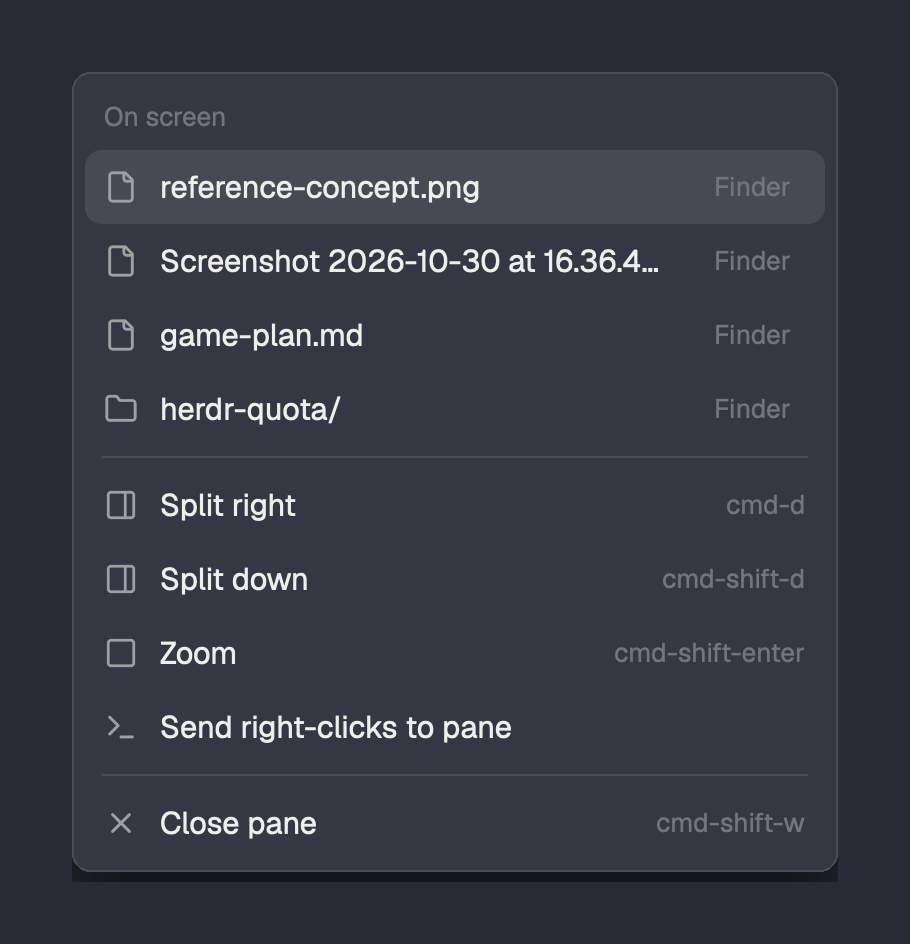

# Path menu

Herdr's terminal right-click menu, with the files and folders on screen at the top. Click a
name to open it with its app (a folder opens in the file manager); click **Finder** beside it to
show it in its folder. Herdr's own items stay below.

## What you see

- A popup at the pointer, 320 px wide, `popover` background, 12.8 px text.
- A `dim` 11 px heading "On screen", then one 31 px row per path (at most six): the shipped
  `mods/files/file.svg` or `folder.svg` icon (14 px, `muted`), the name (folders end in `/`,
  truncated), and on the right a small "Finder" button (11 px, `dim`, `raised` on hover;
  "Folder" off macOS). Hovering a name shows its full path as a tooltip.
- A 1 px `border` divider, then Herdr's pane items unchanged: Split right, Split down, Zoom,
  right-click routing, Close pane, with their key hints.

## How it behaves

- On a terminal right-click the menu opens at Herdr's default size with Herdr's items. It
  reads the clicked terminal's screen, and if it finds paths it closes itself and reopens at
  the pointer, 320 px wide and as tall as its rows. Without paths it stays as it was.
- Paths: words that start like `/x`, `~/`, `./`, `../`, `dir/`, or a whole `name.ext`, after
  leading quotes, backticks or brackets. Each start also tries up to six words (names with
  spaces) and, at a line end, the next line's first word (wrapped paths). Trailing prose
  punctuation and `:12`, `:12:3`, `#L4` suffixes are dropped. Relative paths resolve
  against the pane's folder. The longest candidate that exists wins; duplicates, `/` and the
  pane's own folder are skipped. Order: lowest row first, right to left.
- A bare `name.ext` that does not exist in the pane's folder is looked up below it:
  `git ls-files --cached --others --exclude-standard` in a work tree, else `find -maxdepth 6`
  (skipping `.git` and `node_modules`); up to two matches per name, twelve names per menu.
- Clicking a name runs `open <path>` (`xdg-open` on Linux, `explorer` on Windows); "Finder"
  runs `open -R <path>` (Linux: opens the parent folder; Windows: `explorer /select,`). Both
  close the menu. ↑/↓ and Enter work on every row as in Herdr's menu.
- Terminals on other machines are not scanned.

## Built from

- Layout root: `"terminal_menu": "path-menu"`.
- `mods/path-menu/main.js`: Herdr's shipped `menu` mod (Apache-2.0) with a `paths` prop, an
  `"open"` item kind, the reveal button and a `height(list)` helper. It reopens itself with
  `openOverlay({ mod: "path-menu", kind: "popup", width: 320, height, props: { ...props, paths } })`.
- `mods/path-menu/paths.js`: `hc(["read", terminal])`, then one
  `exec("sh", ["-c", CHECK, "paths", ...candidates], { cwd })` that prints kind, candidate
  and absolute path for each one that exists. Candidates are arguments, never script text.
- `herdr` API: `props`, `panes` (the pane's `cwd`), `hc`, `exec`, `openOverlay`,
  `closeOverlay`, `window().platform`, `theme`, `keys`.

## Watch out

- The menu's props say which terminal was clicked, not where; there is no clicked word.
- A popup's size is fixed when it opens, so the reopen is what fits it to the rows.
- Prose words like `e.g.` look like `name.ext`; only existing paths survive, so a file named
  like a common word in the pane's folder (`README.md`) can show up.
- An `.app` is a folder that `open` launches.

## Done when

- `herdr-app check mods/path-menu` passes.
- With `/tmp`, `~/Desktop` and a relative `name.png` from the pane's folder on screen, a
  right-click lists all three, newest first.
- Clicking an image opens it in the image viewer; "Finder" shows it selected in its folder.
- A path with spaces and one wrapped across two lines are both found.
- With no paths on screen, the menu is exactly Herdr's.
